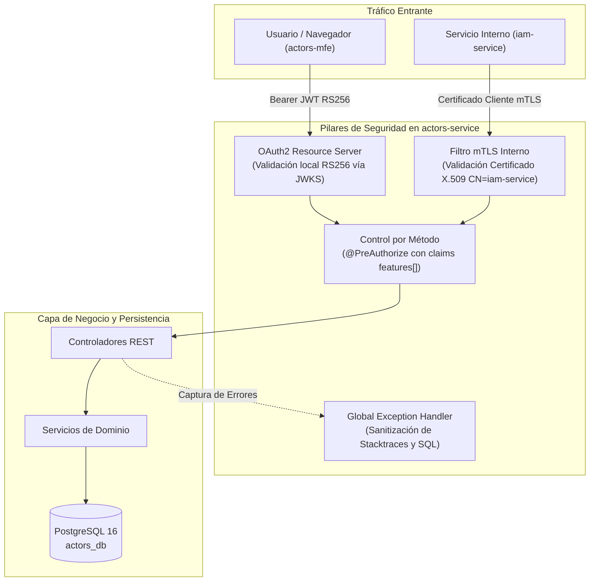

# ADR-015: Arquitectura de Seguridad y Control de Acceso para actors-service (OAuth2 RS256, mTLS y RBAC Granular)

**Estado:** PROPOSED (En proceso de validación y certificación QA)  
**Fecha:** 2026-10-19 (Actualizado: 2026-10-21)  
**Autores:** Laura Vanessa Pérez Perdomo (ADSO Ficha 3145555 · `@vanessaperdomo`)  
**Equipos involucrados:** Arquitectura, Backend (Dominio Actores), Seguridad  

---

## Contexto

El microservicio `actors-service` es el componente autoritativo del ecosistema SENA Horarios para la gestión de aprendices, instructores, contratos, asignación de competencias, matrículas en fichas y bitácoras de seguimiento. Este microservicio procesa Datos Personales Sensibles protegidos en Colombia por la **Ley Estatutaria 1581 de 2012 (*Habeas Data*)**.

El servicio atiende dos tipos principales de peticiones:
1. **Tráfico externo de usuarios:** Peticiones originadas desde navegadores y microfrontends (`actors-mfe`) a través del API Gateway (Traefik).
2. **Tráfico interno servicio a servicio (M2M):** Peticiones entre microservicios de la red interna Docker (`iam-service`, `academic-management-service`) para sincronización masiva y validación de entidades.

### Desafíos Arquitectónicos:
- **Latencia y acoplamiento síncrono:** Consultar al proveedor de identidad (`iam-service`) en cada petición HTTP para verificar tokens generaría entre 20 y 50 ms de sobrecarga por llamada y un Punto Único de Falla (SPOF).
- **Seguridad en la red interna:** Las rutas privadas de sincronización (`/internal/learners/**`) no pueden confiar únicamente en el aislamiento de red o en tokens de usuario que puedan ser interceptados.
- **Principio de menor privilegio:** Se requiere autorización estricta para evitar accesos no autorizados a expedientes ajenos (IDOR) o escalamiento de privilegios entre aprendices e instructores.

---

## Decisión

Se decide usar **validación descentralizada de tokens JWT asimétricos con algoritmo RS256 mediante llaves públicas JWKS** para el tráfico de usuarios, complementada con **autenticación mutua por certificados digitales (mTLS X.509)** para las rutas internas de sincronización y **control de acceso granular basado en roles y scopes (RBAC)** a nivel de método.

### Pilares de la Implementación:

1. **Servidor de Recursos OAuth2 Descentralizado (`SecurityConfig.java`):**
   - El microservicio opera como un Spring Security OAuth2 Resource Server 100% sin estado (`SessionCreationPolicy.STATELESS`).
   - Valida la firma criptográfica asimétrica RS256 en memoria local utilizando la clave pública descargada del endpoint JWKS de IAM (`/.well-known/jwks.json`).
   - Rechaza tokens expirados (`exp`), malformados o con algoritmo `none` con HTTP 401 y envelope estándar (`TOKEN_EXPIRED`, `TOKEN_INVALID`, `MISSING_TOKEN`).

2. **Autenticación Mutua TLS (mTLS) para Rutas Internas (`InternalMtlsAuthenticationFilter.java`):**
   - El filtro intercepta exclusivamente peticiones dirigidas a `/internal/learners/**`.
   - Extrae el certificado X.509 del cliente desde `jakarta.servlet.request.X509Certificate`.
   - Valida que el sujeto del certificado coincida con `CN=iam-service` (configurable vía `actors.internal.mtls.trusted-subject`).
   - Asigna la autoridad interna `ACTORS_INTERNAL_IAM`. Peticiones sin certificado o con certificados no confiables son rechazadas con HTTP 401 (`MTLS_CERTIFICATE_REQUIRED`, `MTLS_CERTIFICATE_UNTRUSTED`).

3. **Mapeo de Scopes y Autorización Granular (RBAC):**
   - El convertidor `JwtAuthenticationConverter` extrae el claim `features[]` (con formato `FEATURE:SCOPE`) y genera GrantedAuthorities de Spring Security (`ACT_INSTRUCTOR_MANAGE`, `ACT_LEARNER_VIEW`, `ACT_ACTIVITY_LOG_VIEW`, etc.).
   - Los métodos de los controladores y adaptadores aplican `@PreAuthorize` para garantizar que un aprendiz nunca acceda a funciones administrativas de instructor ni consulte fichas/centros fuera de su asignación.
   - Aislamiento real de Centro de Formación evaluado en `@PreAuthorize("@instructorAuth.canView(#trainingCenterId)")` contra el claim `training_center_id` y scopes `TRAINING_CENTER_...`.
   - Protección estricta contra IDOR en `@PreAuthorize("@learnerAuth.canAccessLearner(#id)")` verificando el contrato `learner.id == actor_id`.

4. **Manejo Centralizado de Excepciones (`GlobalExceptionHandler.java`):**
   - Retorna respuestas JSON estructuradas (`ErrorResponse`) con códigos de negocio (`INSUFFICIENT_PERMISSIONS`, `VALIDATION_ERROR`, `INTERNAL_ERROR`).
   - Oculta por completo trazas de pila (*stacktraces*), dialectos SQL y nombres de tablas de PostgreSQL ante excepciones no controladas (HTTP 500).

---

## Consecuencias

### Positivas
- **Cero latencia de red en autenticación:** La validación criptográfica de tokens se hace en memoria local vía llaves públicas cacheadas de JWKS.
- **Defensa en profundidad para rutas M2M:** La sincronización de aprendices exige certificado digital X.509 válido, impidiendo el acceso incluso ante fugas de credenciales de usuario.
- **Cumplimiento estricto de Habeas Data:** Mitigación de riesgos de fuga de datos sensibles de instructores y aprendices.
- **Prevención de escalamiento IDOR:** Validación por método con scopes a nivel de Centro de Formación y Ficha.

### Negativas / Trade-offs
- Se requiere gestión de infraestructura para la rotación periódica de certificados mTLS entre microservicios.
- Se debe sincronizar el cache local de JWKS ante eventos de rotación de claves asimétricas de `iam-service`.

---

## Trazabilidad y Verificación

- **Suite de Pruebas Negativas:** `actors-adapters/src/test/java/co/sena/actors/adapter/in/rest/SecurityNegativeTests.java` (16 tests aprobados, incluyendo caso positivo de centro).
- **Pruebas de Criptografía RSA:** `actors-adapters/src/test/java/co/sena/actors/adapter/config/NimbusJwtCryptographicTest.java` (RSA 2048-bit, rechazo de firma alterada y alg:none).
- **Pruebas de Contrato IDOR:** `actors-adapters/src/test/java/co/sena/actors/adapter/in/rest/LearnerAuthTest.java` (6 tests unitarios).
- **Prueba de Inyección SQL en Persistencia:** `actors-adapters/src/test/java/co/sena/actors/adapter/out/persistence/LearnerPersistenceSqlInjectionIT.java` (PostgreSQL Testcontainers).
- **Pull Request Oficial:** [code-sena/design-software-actors-service#27](https://github.com/code-sena/design-software-actors-service/pull/27).
