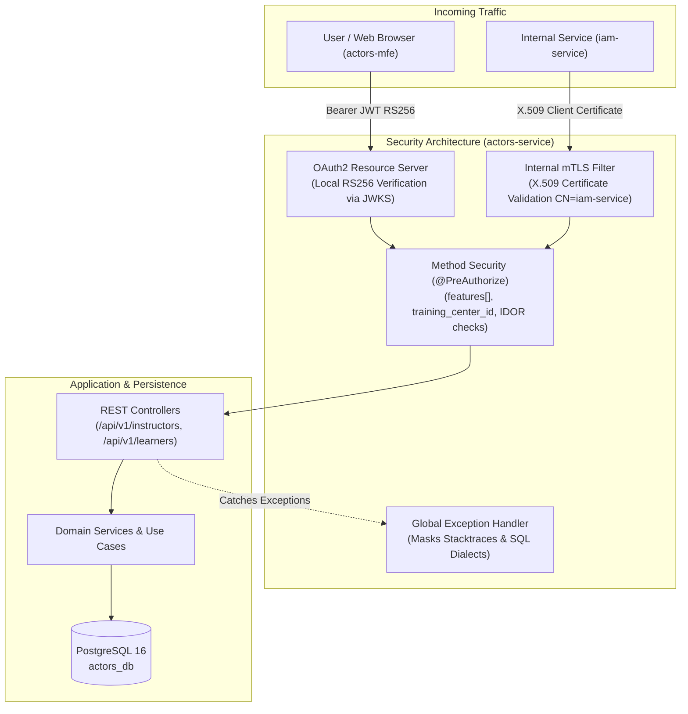

# ADR-019: Actors Service Security Hardening, Decentralized OAuth2 RS256, Mutual TLS (mTLS), and Granular Scope-Based Access Control

**Status:** PROPOSED  
**Date:** 2026-10-21 (Updated: 2026-10-23)  
**Authors:** Laura Vanessa Pérez Perdomo (ADSO Ficha 3145555 · `@vanessaperdomo`)  
**Teams involved:** Architecture, Actors Domain Backend, Security, Quality  
**Scope:** `design-software-actors-service` — Improvement Plan (Acta No. 02 - 2026, Individual Challenge R4)  

---

## Context

The `actors-service` is the authoritative component in the SENA Horarios ecosystem for managing learners, instructors, contracts, competency assignments, ficha enrollments, and academic tracking logs. It manages Sensitive Personal Data (PII) protected in Colombia by **Statutory Law 1581 of 2012 (*Habeas Data*)**.

In the distributed microservice architecture of `design-software`, the service processes two main traffic profiles:
1. **External user traffic:** Requests originating from web browsers and microfrontends (`actors-mfe`) routed via the Traefik API Gateway.
2. **Internal machine-to-machine (M2M) traffic:** Synchronous inter-service calls across the Docker container network (e.g., from `iam-service` and `academic-management-service`) for learner validation and active ficha resolution.

### Architectural Challenges Prior to Hardening:
- **Synchronous coupling & latency:** Verifying tokens synchronously against the identity provider (`iam-service`) on every HTTP invocation introduces 20–50 ms of network latency and creates a Single Point of Failure (SPOF).
- **Internal perimeter vulnerability:** Private synchronization routes (`/internal/learners/**`) cannot rely solely on Docker network isolation or delegated user bearer tokens, which risk spoofing or interception.
- **Cross-tenant privilege escalation & IDOR:** Lack of fine-grained multi-tenant scope isolation (training centers and fichas) could allow instructors or learners to access or mutate records outside their institutional assignment.
- **Information disclosure:** Unhandled exceptions exposed database schemas, PostgreSQL error dialects, and JVM stack traces.

---

## Decision

We decide to implement an **asymmetric cryptographic JWT validation layer with decentralized JWKS verification (RS256) for user traffic, mutual TLS (mTLS X.509) client authentication for internal machine-to-machine routes, and method-level granular role-and-scope access control (RBAC)** in `actors-service`.

The decision comprises four core architectural pillars:

### 1. Decentralized OAuth2 Resource Server (`SecurityConfig.java`)
- The microservice operates as a completely stateless Spring Security OAuth2 Resource Server (`SessionCreationPolicy.STATELESS`).
- Validates the RS256 asymmetric cryptographic signature in local memory against public keys retrieved from IAM's JSON Web Key Set endpoint (`/.well-known/jwks.json`).
- Rejects expired tokens (`exp`), unsigned tokens (`alg: none`), and malformed tokens with HTTP 401 and structured business error envelopes (`TOKEN_EXPIRED`, `TOKEN_INVALID`, `MISSING_TOKEN`).

### 2. Mutual TLS (mTLS) for Internal Routes (`InternalMtlsAuthenticationFilter.java`)
- Internal synchronization endpoints under `/internal/learners/**` are intercepted by a dedicated servlet filter prior to standard authentication.
- Extracts the client X.509 certificate from `jakarta.servlet.request.X509Certificate`.
- Enforces subject identity matching (`CN=iam-service`, configurable via `actors.internal.mtls.trusted-subject`).
- Assigns internal authority `ACTORS_INTERNAL_IAM`. Requests lacking client certificates or presenting untrusted certificates fail with HTTP 401 (`MTLS_CERTIFICATE_REQUIRED`, `MTLS_CERTIFICATE_UNTRUSTED`).

### 3. Granular RBAC, Multi-Tenant Scopes, and IDOR Prevention
- `JwtAuthenticationConverter` parses the `features[]` claim array (format `FEATURE:SCOPE`) and maps them to Spring Security `GrantedAuthority` objects (`ACT_INSTRUCTOR_VIEW`, `ACT_INSTRUCTOR_MANAGE`, `ACT_LEARNER_VIEW`, etc.).
- Method security (`@PreAuthorize`) prevents role escalation (e.g., learners attempting instructor registration or modifications).
- **Training Center Isolation:** Enforced via `@PreAuthorize("@instructorAuth.canView(#trainingCenterId)")` against the token's `training_center_id` claim.
- **Ficha Scope Isolation:** Restricts queries to authorized `ficha_id` scopes.
- **IDOR Protection:** Enforced via `@PreAuthorize("@learnerAuth.canViewLearner(#id)")` and `@PreAuthorize("@learnerAuth.canManageLearner(#id)")`, ensuring learners with `OWN_PROFILE` can only view and update their own identity.

### 4. Robustness, Sanitization, and Error Masking (`GlobalExceptionHandler.java`)
- Input validation sanitizes parameters against SQL injection and blocks XSS payloads in request bodies (`@Pattern(regexp = "^[^<>]*$")`) returning HTTP 400 (`VALIDATION_ERROR`).
- `ReportRateLimiter` applies a concurrent rate-limiting filter against heavy reporting endpoints, returning HTTP 429 (`TOO_MANY_REQUESTS`).
- `GlobalExceptionHandler` converts unhandled exceptions into uniform JSON error payloads (`INTERNAL_ERROR`), completely masking internal stack traces, PostgreSQL dialects, and database table names.

---

## Consequences

### Positive
- **Elimination of Auth Latency:** In-memory RS256 cryptographic verification eliminates round-trip HTTP overhead to `iam-service`.
- **Zero-Trust Defense-in-Depth for Internal Routes:** M2M synchronization endpoints require verifiable cryptographic certificates, preventing lateral movement within the Docker network.
- **Regulatory Habeas Data Compliance:** PII of learners and instructors is safeguarded against unauthorized multi-tenant queries and IDOR attacks.
- **Information Leakage Prevention:** Eliminates schema and error trace leakage on HTTP 500 failures.
- **Automated CI Validation:** Backed by 16 automated negative tests (`SecurityNegativeTests`), cryptographic unit tests (`NimbusJwtCryptographicTest`), IDOR tests (`LearnerAuthTest`), and database SQL injection integration tests (`LearnerPersistenceSqlInjectionIT`).

### Negative / Trade-offs
- Requires operational management and rotation of X.509 mTLS certificates across internal microservices.
- Requires coordinated JWKS key caching and rotation handling when `iam-service` rolls its RSA key pairs.

---

## Considered Alternatives

| Alternative | Reason for Rejection |
|---|---|
| **Synchronous Token Introspection against IAM** | Incurs 20–50 ms latency per request and turns `iam-service` into an availability SPOF. |
| **Symmetric HS256 Shared Secret** | Requires distributing shared secrets across all microservices, increasing key compromise risk compared to asymmetric public key distribution (RS256 via JWKS). |
| **Network-Only Isolation for `/internal/**`** | Fails Zero-Trust principles; any container compromised on the internal bridge network could spoof unauthenticated calls to internal endpoints. |
| **Permissive Scope Fallback (Fail-Open)** | Creates critical security vulnerabilities by defaulting to permissive access when custom tenant claims are omitted. |

---

## References

- [09-microservices/services/06-actors-service/security.md](../../09-microservices/services/06-actors-service/security.md)
- [11-quality/qa-report-r4-security-actors.md](../../11-quality/qa-report-r4-security-actors.md)
- [09-microservices/services/06-actors-service/decisions.md](../../09-microservices/services/06-actors-service/decisions.md)
- OWASP Application Security Verification Standard (ASVS v4.0.3) Level 1
- Backend Implementation PR: [code-sena/design-software-actors-service#27](https://github.com/code-sena/design-software-actors-service/pull/27)
