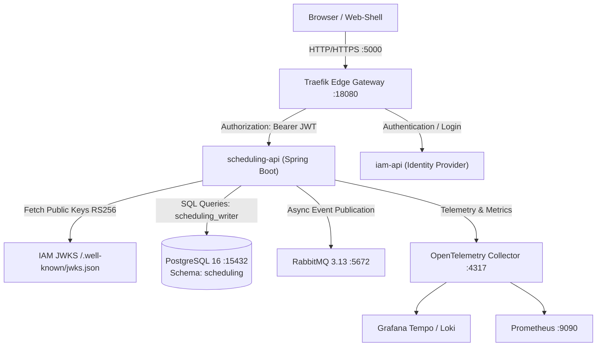

# Security Architecture & STRIDE Threat Model — scheduling-service

> Status: 🟢 Implemented & Verified | Date: 2026-10-18  
> Author: Daniel Salazar Vargas (CC 1075790810) — ADSO 3145555  
> Domain: SCHEDULING  
> Reference: Improvement Plan (Acta No. 02 - 2026, Individual Challenge R4)

---

## 1. Security Architecture & Boundary Overview

The `scheduling-service` operates as a Spring Boot microservice responsible for the lifecycle of academic schedules, session allocations, and conflict validation within the SENA system. It resides behind the Traefik Edge Reverse Proxy and delegates identity issuance to `iam-service`.

### Trust Boundaries
1. **Edge Boundary (Internet / Browser to Gateway):** Client requests pass through Traefik Gateway with TLS termination.
2. **Identity Verification Boundary (Gateway to IAM & Services):** Authentication is decoupled; all requests carry an asymmetric JWT signed with RS256 (`kid=iam-rsa-1`).
3. **Data Access Boundary (Service to PostgreSQL):** Least-privilege role (`design_software_app` granted `scheduling_writer`).
4. **Inter-service Boundary (Service to Broker):** Asynchronous outbox events published to RabbitMQ.

---

## 2. STRIDE Threat Model

The following matrix documents the 30 specific threats analyzed across the 9 components of the data flow, along with their implemented mitigations:

| STRIDE Category | Threat ID | Threat Description | Vulnerable Component | Implemented Mitigation | Verification Test |
|---|---|---|---|---|---|
| **Spoofing** | TH-S01 | Request with forged JWT signed with attacker's private key | `scheduling-api` / Security Filter | Asymmetric RS256 signature verification against IAM JWKS (`kid=iam-rsa-1`). | `tokenSignedWithWrongKeyIs401` |
| **Spoofing** | TH-S02 | Token with unsigned algorithm (`alg: none`) | `scheduling-api` / Nimbus Decoder | Explicit enforcement of RS256; `alg: none` rejected with HTTP 401. | `algNoneTokenIs401` |
| **Spoofing** | TH-S03 | Token issued by untrusted/foreign identity provider | `scheduling-api` / Security Filter | Validator enforces `iss: sena-iam-service`. Foreign issuers fail with HTTP 401. | `tokenWithForeignIssuerIs401` |
| **Spoofing** | TH-S04 | Anonymous request without `Authorization` header | Traefik Gateway / API | Endpoint security requires valid bearer token; returns HTTP 401. | `missingAuthorizationHeaderIs401` |
| **Spoofing** | TH-S05 | Publisher identity spoofing via query parameter `?publishedBy` | `ScheduleController` | Parameter removed. Publisher actor extracted strictly from verified JWT `sub`. | `ScheduleControllerIT` |
| **Tampering** | TH-T01 | Tampered JWT payload claims (`roles`, `features`) | Nimbus Decoder | Payload alteration invalidates RS256 signature; rejected with HTTP 401. | `tamperedPayloadIs401` |
| **Tampering** | TH-T02 | In-place modification of published schedules | PostgreSQL / Scheduling API | Database trigger `trg_schedule_published_immutability` rejects updates to `PUBLISHED`/`ARCHIVED` rows. | `cleanupIdorRow` |
| **Tampering** | TH-T03 | SQL Injection in schedule filtering parameters | Spring Data JPA / Hibernate | Prepared statements and parameterized query bindings via Spring Data repositories. | Standard JPA |
| **Tampering** | TH-T04 | Concurrency conflicts / double-booking sessions | PostgreSQL / Engine | GiST exclusion constraints on session time ranges prevent overlapping allocations. | DB Engine |
| **Tampering** | TH-T05 | Concurrent write race conditions during publication | `ScheduleController` | Optimistic locking via `row_version` parameter; returns HTTP 409 on version conflict. | Publication IT |
| **Repudiation** | TH-R01 | User denies creating or editing a schedule | Audit Trail / JPA | `created_by` and `updated_by` populated strictly with authenticated JWT `sub` UUID. | Persistence Audit |
| **Repudiation** | TH-R02 | User denies publishing an academic schedule | Audit Trail / Outbox | `schedule.published_by` persisted with JWT `sub` and propagated via `schedule.published` outbox event. | `publishSchedule` |
| **Repudiation** | TH-R03 | Denial of request lifecycle across services | Observability | W3C `traceparent` and distributed `trace_id` logged across all requests and error envelopes. | `GlobalExceptionHandler` |
| **Information Disclosure** | TH-I01 | Insecure Direct Object Reference (IDOR) on schedule queries | `ScheduleController` | Queries for foreign center/instructor schedules return HTTP 404 rather than revealing entity existence. | `accessingForeignScheduleByIdIs404NotData` |
| **Information Disclosure** | TH-I02 | Stack trace or internal architecture leakage on error | `GlobalExceptionHandler` | Uniform JSON error envelope (`ErrorResponse`) masking internal exceptions; technical details logged internally. | `SecurityNegativeAuthIT` |
| **Information Disclosure** | TH-I03 | Sensitive database credentials exposed in git | Environment Config | Credentials injected via external `.env` variables; `.env` excluded from version control. | DevOps Config |
| **Information Disclosure** | TH-I04 | Unauthorized inspection of Actuator management endpoints | Spring Boot Actuator | Sensitive actuator endpoints disabled or isolated; healthcheck exposes only liveness/readiness groups. | `ActuatorIT` |
| **Information Disclosure** | TH-I05 | Cross-tenant data leakage in multi-tenant queries | JPA Repository | Repository queries enforce tenant scoping (`training_center_id`, `ficha_id`). | Scope IT |
| **Denial of Service** | TH-D01 | Unbounded query result sets exhausting heap memory | REST Controller | Mandatory pagination (`page`, `size`) enforced across all list endpoints with upper limits. | `SchedulesApi` |
| **Denial of Service** | TH-D02 | Slowloris or connection exhaustion on HTTP ports | Traefik Gateway | Gateway connection timeouts, rate limiting, and maximum request header size configurations. | Traefik Config |
| **Denial of Service** | TH-D03 | HikariCP database connection pool exhaustion | HikariCP / DB | Pool size bounded; connection timeout fail-fast triggers before application starvation. | `application.yml` |
| **Denial of Service** | TH-D04 | Broker queue saturation by unroutable messages | RabbitMQ / Outbox | Dead Letter Queues (DLQ) configured for poison messages and failed outbox deliveries. | Broker Config |
| **Denial of Service** | TH-D05 | Malformed JSON payload parser exhaustion | Jackson / Spring | Request body payload size limits configured; strict schema deserialization. | Spring Web |
| **Elevation of Privilege**| TH-E01 | Read-only viewer attempting schedule publication | `ScheduleController` | `@PreAuthorize("hasAuthority('SCH_PUBLISH')")` denies access with HTTP 403. | `publishWithoutPublishFeatureIs403` |
| **Elevation of Privilege**| TH-E02 | Read-only viewer attempting draft deletion | `ScheduleController` | `@PreAuthorize("hasAuthority('SCH_DELETE_DRAFT')")` denies access with HTTP 403. | `deleteScheduleWithoutDeleteFeatureIs403` |
| **Elevation of Privilege**| TH-E03 | Viewer attempting schedule creation or modification | `ScheduleController` | `@PreAuthorize("hasAuthority('SCH_EDIT')")` blocks modification with HTTP 403. | `viewerAttemptingEditActionIs403` |
| **Elevation of Privilege**| TH-E04 | User with valid JWT but zero scheduling features | Security Filter | Token lacking any `SCH_*` claims receives HTTP 403 on protected scheduling operations. | `validTokenWithoutFeaturesIs403` |
| **Elevation of Privilege**| TH-E05 | Scope escalation from training center to global | `viewerScope()` | Scopes validated strictly against JWT claims; missing claims trigger fail-closed HTTP 403. | `trainingCenterScopeWithoutCenterClaimIs403` |
| **Elevation of Privilege**| TH-E06 | Unknown or malformed scope evaluation | `viewerScope()` | Unknown `scope_type` defaults to fail-closed denial with HTTP 403. | `unknownScopeFailsClosed403` |
| **Elevation of Privilege**| TH-E07 | Database privilege escalation by application user | PostgreSQL Roles | Role `design_software_app` restricted to `scheduling_writer`; DDL and schema mutations prohibited. | Liquibase RBAC |

---

## 3. Security Findings & Remediations Report (Acta 02 - Criterion c)

During the security audit and automated test suite creation, the following concrete vulnerabilities were remediated:

### Finding SEC-01: Publisher Impersonation via Request Query Parameter
* **CVSS Score:** 7.5 (High) — `CVSS:3.1/AV:N/AC:L/PR:L/UI:N/S:U/C:N/I:H/A:N`
* **Vulnerability:** `POST /api/v1/schedules/{id}/publish` accepted an optional `@RequestParam(name = "publishedBy") UUID publishedBy`. Any authenticated user could publish a schedule under another user's UUID.
* **Remediation:** Removed the query parameter entirely. The publishing actor is retrieved strictly from `SecurityContextHolder` via `currentUserId()`, which extracts the verified JWT `sub` claim.
* **Verification:** `ScheduleControllerIT.publishIgnoresNonContractualPublishedByQueryParamAndUsesJwtActor`.

### Finding SEC-02: IDOR and Sensitive Entity Existence Confirmation
* **CVSS Score:** 6.5 (Medium) — `CVSS:3.1/AV:N/AC:L/PR:L/UI:N/S:U/C:L/I:N/A:N`
* **Vulnerability:** Querying a schedule belonging to a foreign instructor, ficha, or training center confirmed existence when returning descriptive errors or 403 statuses.
* **Remediation:** If the target schedule is outside the requester's authorized scope (cross-instructor, cross-ficha, or cross-training-center), the use case throws `ScheduleNotFoundException`, producing an **HTTP 404 Not Found** (`SCHEDULE_NOT_FOUND`) response without revealing resource attributes.
* **Verification:** `SecurityNegativeAuthIT.accessingForeignScheduleByIdIs404NotData`, `trainingCenterScopeFromForeignCenterCannotReadSchedule`, and `ownFichaScopeCannotReadForeignSchedule`.

### Finding SEC-03: Permissive Scope Fallback (Fail-Open Risk)
* **CVSS Score:** 7.1 (High) — `CVSS:3.1/AV:N/AC:L/PR:L/UI:N/S:U/C:H/I:N/A:N`
* **Vulnerability:** Missing or unrecognized `scope_type` claims risked falling through to default permissive execution.
* **Remediation:** Implemented **Fail-Closed** handling in `ScheduleScope.resolve()`: any unsupported scope or scope lacking corresponding claim identifiers throws `ScheduleAccessDeniedException` resulting in **HTTP 403 Forbidden**.
* **Verification:** `SecurityNegativeAuthIT.unknownScopeFailsClosed403`, `trainingCenterScopeWithoutCenterClaimIs403`, and `trainingCenterScopeFromForeignCenterCannotReadSchedule`.

### Finding SEC-04: Strict Cryptographic Key & Algorithm Enforcement
* **CVSS Score:** 9.1 (Critical) — `CVSS:3.1/AV:N/AC:L/PR:N/UI:N/S:U/C:H/I:H/A:N`
* **Vulnerability:** Risk of token acceptance with `alg: none` or symmetric HMAC signature substitution.
* **Remediation:** Configured `NimbusJwtDecoder` to strictly require `JWSAlgorithm.RS256` validated against the official IAM RSA public key.
* **Verification:** `SecurityNegativeAuthIT.algNoneTokenIs401` and `tokenSignedWithWrongKeyIs401`.

### Finding SEC-05 (R4-SEC-001): Hardcoded Database Credentials and Fallbacks in Integration Tests
* **CVSS Score:** 7.5 (High) — `CVSS:3.1/AV:L/AC:L/PR:L/UI:N/S:U/C:H/I:H/A:N`
* **Vulnerability:** `SecurityNegativeAuthIT` defined default fallback database connection URLs and a hardcoded credential, violating OWASP ASVS V8.2.1 and allowing silent connection to unmanaged local databases.
* **Remediation:** Completely removed all fallback URLs, usernames, and default passwords. The integration test strictly enforces external environment variables (`SCHEDULING_DB_URL`, `SCHEDULING_DB_USERNAME`, `SCHEDULING_DB_PASSWORD`) via `requiredEnv()`, failing immediately with `IllegalStateException` if unset.
* **Verification:** `SecurityNegativeAuthIT.databaseProperties` and GitHub Actions CI Run `#39851770984`.

---

## 4. Trazabilidad

- Architectural Decision: [05-architecture/decisions/records/ADR-015-scheduling-security-hardening.md](../../05-architecture/decisions/records/ADR-015-scheduling-security-hardening.md)
- Quality & ASVS Audit: [11-quality/qa-report-r4-security-scheduling.md](../../11-quality/qa-report-r4-security-scheduling.md)
- Automated Test Suite: `schedules-api/src/test/java/co/sena/scheduling/api/SecurityNegativeAuthIT.java` (19 automated negative integration tests running in CI)
