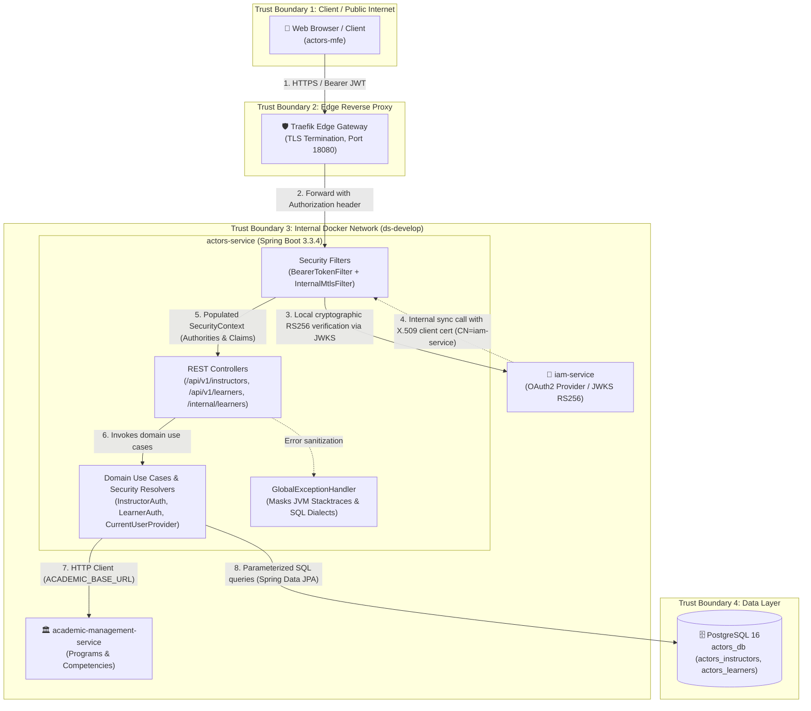

# Security Architecture & STRIDE Threat Model — actors-service

> Status: 🟢 Implemented & Verified | Date: 2026-10-21 (Updated: 2026-10-23)  
> Author: Laura Vanessa Pérez Perdomo (`@vanessaperdomo`) — ADSO 3145555  
> Domain: ACTORS  
> Reference: Improvement Plan (Acta No. 02 - 2026, Individual Challenge R4)

---

## 1. Security Architecture & Boundary Overview

The `actors-service` (Spring Boot 3.3.4 / Java 17) is the authoritative microservice responsible for the lifecycle of learners, instructors, contracts, competency assignments, ficha enrollments, and tracking logs within the SENA Horarios ecosystem.

Because it processes Sensitive Personal Identifiable Information (PII) protected in Colombia by **Statutory Law 1581 of 2012 (*Habeas Data*)**, its attack surface encompasses three operational boundaries:
1. **Edge Reverse Proxy Boundary:** Client requests originating from microfrontends (`actors-mfe`) through Traefik Gateway.
2. **Internal Machine-to-Machine Boundary:** Synchronous inter-service calls across the Docker internal network (`iam-service`, `academic-management-service`).
3. **Data Access Boundary:** Dedicated PostgreSQL schemas (`actors_instructors`, `actors_learners`, `actors_tracking`) accessed via Spring Data JPA and HikariCP.

---

## 2. STRIDE Threat Model Matrix

The following matrix documents the specific threats analyzed across the data flow, along with their implemented mitigations and verification test cases:

| STRIDE Category | Threat ID | Evaluated Threat Description | Vulnerable Component | Implemented Mitigation | Verification Test |
|---|:---:|---|---|---|---|
| **Spoofing** | TH-S01 | Expired JWT bearer token | OAuth2 Filter | Cryptographic verification validates `exp` timestamp claim; rejects with HTTP 401 (`TOKEN_EXPIRED`). | `test01_expiredToken_returns401TokenExpired` |
| **Spoofing** | TH-S02 | Tampered cryptographic signature | OAuth2 Filter / Nimbus | Asymmetric RS256 signature verification rejects modified tokens with HTTP 401 (`TOKEN_INVALID`). | `test02_invalidSignature_returns401TokenInvalid` |
| **Spoofing** | TH-S03 | Signature bypass via `{"alg": "none"}` | `NimbusJwtDecoder` | Explicit enforcement of RS256; `alg: none` rejected with HTTP 401 (`TOKEN_INVALID`). | `test03_algorithmNone_returns401TokenInvalid` |
| **Spoofing** | TH-S04 | Anonymous request missing `Authorization` header | `SecurityConfig` | Protected endpoints enforce mandatory Bearer token; rejects with HTTP 401 (`MISSING_TOKEN`). | `test04_missingAuthorizationHeader_returns401MissingToken` |
| **Spoofing** | TH-S05 | Rogue caller on private internal route `/internal/learners/**` | `InternalMtlsAuthenticationFilter` | Mandatory client X.509 certificate validation with a per-caller CN allow-list per path family (see [Internal mTLS design](#35-internal-mtls-design-hu-act-492)); an absent certificate is rejected with HTTP 401 (`MTLS_CERTIFICATE_REQUIRED`), a CN not allowed for the path with HTTP 403 (`MTLS_CLIENT_NOT_ALLOWED`). | `test14_untrustedMtlsClientCallingInternalLearners_returnsUnauthorized` |
| **Tampering** | TH-T01 | SQL Injection in filtering query parameters | Spring Data JPA / Hibernate | 100% parameterized queries via Spring Data JPA; malicious SQL fragments are treated as literal strings without error 500. | `test11_sqlInjectionInQueryParams_sanitizedWithout500` |
| **Tampering** | TH-T02 | Stored XSS injection in JSON text fields | Bean Validation / Jackson | Strict pattern validation `@Pattern(regexp = "^[^<>]*$")` on names; rejects malicious tags with HTTP 400 (`VALIDATION_ERROR`). | `test12_xssPayloadInBody_rejectedWith400ValidationError` |
| **Tampering** | TH-T03 | Malformed or corrupted authorization header | `BearerTokenAuthenticationFilter` | Bad JWT format triggers immediate rejection with HTTP 401 (`TOKEN_INVALID`). | `test05_malformedHeader_returns401TokenInvalid` |
| **Repudiation** | TH-R01 | User denies performing learner/instructor modifications | `ActivityLog` / Domain | Append-only audit logging in `activity_log` recording `performed_by` extracted from verified JWT `sub` and UTC timestamp. | `ActivityLogControllerIT` |
| **Information Disclosure** | TH-I01 | Insecure Direct Object Reference (IDOR) on learner record read | `LearnerController` / `LearnerAuth` | `@PreAuthorize("@learnerAuth.canViewLearner(#id)")` restricts users with `OWN_PROFILE` to accessing only their own record; returns HTTP 403. | `test09_idorRead_accessDeniedWithoutLearnerViewAuthority_returns403` |
| **Information Disclosure** | TH-I02 | IDOR on learner record update | `LearnerController` / `LearnerAuth` | `@PreAuthorize("@learnerAuth.canManageLearner(#id)")` prevents cross-tenant modification of learner profiles; returns HTTP 403. | `test10_idorUpdate_modificationDeniedWithoutManageAuthority_returns403` |
| **Information Disclosure** | TH-I03 | Database schema and stack trace leakage on unhandled errors | `GlobalExceptionHandler` | Unhandled exceptions translated to uniform JSON envelopes (`INTERNAL_ERROR`); SQL syntax and stack traces masked completely. | `test15_internalServerError_doesNotLeakStacktraceOrDatabaseSchema` |
| **Denial of Service** | TH-D01 | Excessive burst requests exhausting server resources | `ReportRateLimiter` | In-memory atomic rate limiter throttling burst requests with HTTP 429 (`TOO_MANY_REQUESTS`). | `test13_excessiveRequests_triggersRateLimiting429` |
| **Denial of Service** | TH-D02 | Unbounded pagination query exhausting JVM heap | REST Controllers | Mandatory page limits (`page_size` max bounded) preventing uncontrolled memory consumption. | Pagination validation |
| **Elevation of Privilege** | TH-E01 | Apprentice attempting instructor registration | `@PreAuthorize` / Method Security | Granular RBAC enforces `ACT_INSTRUCTOR_MANAGE`; apprentice role receives HTTP 403 (`INSUFFICIENT_PERMISSIONS`). | `test08_roleEscalation_apprenticeAttemptingInstructorCreation_returns403` |
| **Elevation of Privilege** | TH-E02 | Multi-tenant scope violation across training centers | `InstructorAuth` / Controller | Queries specifying foreign `training_center_id` outside the caller's assigned center are rejected with HTTP 403. | `test06_differentTrainingCenterScope_returns403` |
| **Elevation of Privilege** | TH-E03 | Multi-tenant scope violation across fichas | `LearnerAuth` / Controller | Caller with `ACT_LEARNER_VIEW` scoped to a single ficha attempting to query another ficha receives HTTP 403. | `test07_differentFichaScope_returns403` |

---

## 3. Security Findings & Remediations Report (Acta 02 - Criterion c)

During the security audit and automated test suite creation, the following vulnerabilities were identified and remediated:

### Finding SEC-ACT-01: Multi-Tenant Training Center Scope Escalation
* **Severity:** High (CVSS: 7.5)
* **Vulnerability:** Users possessing `ACT_INSTRUCTOR_VIEW` permissions could query instructor directories across arbitrary training centers by altering the `training_center_id` query parameter.
* **Remediation:** Implemented `InstructorAuth.java` and attached `@PreAuthorize("@instructorAuth.canView(#trainingCenterId)")` to `InstructorController.java`. The evaluator extracts the caller's assigned center scope (`ACT_INSTRUCTOR_VIEW:TRAINING_CENTER_<UUID>`) and rejects cross-center lookups with HTTP 403 (`INSUFFICIENT_PERMISSIONS`). Legitimate queries to the user's assigned center return HTTP 200 OK.
* **Verification:** `SecurityNegativeTests.test06_differentTrainingCenterScope_returns403` and `test06b_sameTrainingCenterScope_isAllowed`.

### Finding SEC-ACT-02: IDOR on Learner Profile Retrieval and Modification
* **Severity:** High (CVSS: 7.4)
* **Vulnerability:** Endpoints `GET /api/v1/learners/{id}` and `PUT /api/v1/learners/{id}` did not verify whether a learner was accessing their own record or an arbitrary record belonging to another learner.
* **Remediation:** Implemented `LearnerAuth.java` evaluating `canViewLearner(#id)` and `canManageLearner(#id)`. For users scoped to `OWN_PROFILE_<UUID>`, the resolver ensures that `id.equals(tokenLearnerId)`. Access to foreign records is rejected with HTTP 403 (`INSUFFICIENT_PERMISSIONS`).
* **Verification:** `SecurityNegativeTests.test09_idorRead_accessDeniedWithoutLearnerViewAuthority_returns403`, `test10_idorUpdate_modificationDeniedWithoutManageAuthority_returns403`, and `LearnerAuthTest`.

### Finding SEC-ACT-03: Perimeter Vulnerability on Internal Learner Synchronization
* **Severity:** High (CVSS: 7.8)
* **Vulnerability:** The route `/internal/learners/by-user/{userId}/active-ficha` could be queried by any network client without cryptographically validating the calling service's identity.
* **Remediation:** Implemented `InternalMtlsAuthenticationFilter.java` intercepting all `/internal/**` requests. The filter verifies that the request includes an X.509 client certificate whose subject is in the allow-list of the path family (initially a single pinned subject; superseded by the per-caller allow-list of HU-ACT-492, section 3.5). Absent certificates trigger HTTP 401 (`MTLS_CERTIFICATE_REQUIRED`), and subjects that are not allowed trigger HTTP 403 (`MTLS_CLIENT_NOT_ALLOWED`). The earlier `MTLS_CERTIFICATE_UNTRUSTED` code and the `CN=iam-service` pin no longer exist.
* **Verification:** `SecurityNegativeTests.test14_untrustedMtlsClientCallingInternalLearners_returnsUnauthorized`.

### Finding SEC-ACT-04: Strict Cryptographic Key and Algorithm Enforcement
* **Severity:** Critical (CVSS: 9.1)
* **Vulnerability:** Potential acceptance of tokens using weak cryptographic schemes, unsigned tokens (`alg: none`), or expired tokens.
* **Remediation:** Configured `SecurityConfig.java` with a custom `NimbusJwtDecoder` enforcing RS256 signatures against IAM JWKS keys, strict issuer validation, and token lifetime verification.
* **Verification:** `SecurityNegativeTests.test01_expiredToken_returns401TokenExpired`, `test02_invalidSignature_returns401TokenInvalid`, `test03_algorithmNone_returns401TokenInvalid`, and `NimbusJwtCryptographicTest`.

### Finding SEC-ACT-05: Information Leakage via Database Exceptions
* **Severity:** Medium (CVSS: 5.3)
* **Vulnerability:** Unhandled exceptions exposed PostgreSQL table names, SQL constraints, and Java stack traces to API consumers.
* **Remediation:** Implemented `GlobalExceptionHandler.java` translating runtime exceptions into standardized `ErrorResponse` objects with sanitized messages (`An unexpected error occurred`), completely hiding internal database structures.
* **Verification:** `SecurityNegativeTests.test15_internalServerError_doesNotLeakStacktraceOrDatabaseSchema`.

### Finding SEC-ACT-06: Learner reads of instructors and the assignment endpoints (HU-ACT-033, 2026-11-03)
* **Context:** `LEARNER` now holds `ACT_INSTRUCTOR_VIEW` at `OWN_FICHA_AS_LEARNER`. `SecurityConfig` also adds the bare authority `ACT_INSTRUCTOR_VIEW`, so every endpoint guarded only by that bare authority would have opened to learners.
* **Learner rule:** `GET /api/v1/instructors` and `/{id}` return only the instructors with an ACTIVE `instructor_ficha_assignment` to the learner's ficha (taken from the learner's active enrollment, not from a claim), as `InstructorSummary` (`id`, `full_name`, `first_name`, `last_name`); any other instructor answers 404; the `document_number` filter answers an empty page so a hidden attribute cannot be probed.
* **Closed to the learner (403):** contracts, areas and competencies (`InstructorViewerAccess.requireVisible` refuses the learner scope) and `GET /instructors/{id}/availability-exceptions` (guard `InstructorAuth.canViewDetails()` instead of the bare authority); `GET /instructors/{id}/fichas` also answers 403.
* **Assignment writes:** `ACT_INSTRUCTOR_FICHA_ASSIGN` with `GLOBAL`, or `TRAINING_CENTER` when the center of the ficha (academic-management, `FichaExistencePort.findTrainingCenterId`) equals the `training_center_id` claim and the instructor's current contract is at that center. Another center answers 403 (ficha) or 404 (instructor); unknown ficha 404; duplicate 409.
* **Verification:** `InstructorFichaAssignmentSecurityTest` (real filter chain, 16 cases), `InstructorFichaAssignmentUseCasesTest` (20 cases) and `InstructorFichaAssignmentPersistenceIT`.

### 3.5 Internal mTLS design (HU-ACT-492)

`actors-api` serves its business port (8080) with TLS and `client-auth: need` (`ACTORS_TLS_CLIENT_AUTH=need`), so a client without a certificate signed by the internal CA never completes the handshake. On top of that, `InternalMtlsAuthenticationFilter` authorizes every `/internal/**` request by the **subject (CN) of the client certificate**, per path family. No runtime behavior is described here that is not already implemented; this section is the design reference.

**Decision flow.** The filter only acts on `/internal` and `/internal/**`. It reads the client certificate from the servlet request and then:

1. No certificate: `401 MTLS_CERTIFICATE_REQUIRED`.
2. The family is resolved from the **decoded and normalized** request path (so encoded or dot-segment variants cannot dodge a pattern). The first family whose Ant pattern matches decides.
3. Path in no family, or certificate subject not in that family's allow-list: `403 MTLS_CLIENT_NOT_ALLOWED` (fail closed).
4. If the family authenticates, the certificate becomes the authentication and the family authority is granted; the chain then requires that authority. If it does not authenticate, the filter is only an additional gate and the request still needs its own Bearer JWT.

Both errors use the standard envelope `{ error_code, message, trace_id }`. The codes are registered in `design-software-shared-contracts` (`errors/error-codes.yaml`).

**Allow-list per caller and path family.**

| Family | Paths | Allowed CN (env var, default) | Authenticates | Authority granted |
|---|---|---|---|---|
| `iam` | `GET /internal/learners/by-user/**` | `ACTORS_INTERNAL_IAM_CLIENT_CN` = `iam-api` | yes | `ACTORS_INTERNAL_IAM` |
| `academic-ownership` | `GET /internal/instructors/{id}/fichas`, `GET /internal/learners/{id}/fichas` | `ACTORS_INTERNAL_ACADEMIC_CLIENT_CN` = `academic-api` | yes | `ACTORS_INTERNAL_ACADEMIC` |
| `academic-fichas` | `GET /internal/fichas/{id}/active-learners/count`, `/internal/fichas/{id}/rap-assessments/coverage` | `ACTORS_INTERNAL_ACADEMIC_CLIENT_CN` = `academic-api` | no (keeps the M2M Bearer JWT, ADR-030) | none from the filter |

Consequence: `iam-api` cannot reach the Academic families and `academic-api` cannot reach the IAM family, even though both hold a valid certificate from the same CA. Any other `/internal/**` path is refused until a family is added.

**Environment variables** (read by `SecurityConfig`; also settable as `actors.internal.mtls.iam-client-cn` / `actors.internal.mtls.academic-client-cn`):

| Variable | Default | Format |
|---|---|---|
| `ACTORS_INTERNAL_IAM_CLIENT_CN` | `iam-api` | Comma-separated CNs, each `[A-Za-z0-9._-]+` |
| `ACTORS_INTERNAL_ACADEMIC_CLIENT_CN` | `academic-api` | Same |

The lists are validated at startup: an invalid CN or an empty list aborts the boot (`IllegalStateException`) instead of silently allowing or denying everything. The old `actors.internal.mtls.trusted-subject` (default `CN=iam-service`) no longer applies.

**Failure codes.**

| HTTP | `error_code` | Cause | First check |
|---|---|---|---|
| 401 | `MTLS_CERTIFICATE_REQUIRED` | No client certificate reached the filter on `/internal/**` | The caller's key store (`*_ACTORS_MTLS_KEY_STORE`) is mounted and loaded; the call goes to `https://actors-api:8080`, not through a proxy that terminates TLS |
| 403 | `MTLS_CLIENT_NOT_ALLOWED` | The certificate CN is not in the family allow-list, or the path belongs to no family | The CN of the caller's certificate vs the env var of the family; the path spelling |

**Compose and infra.** The names live in `design-software-docker-infra`: `docker-compose.yml` (service `actors-api`) passes `ACTORS_INTERNAL_IAM_CLIENT_CN` and `ACTORS_INTERNAL_ACADEMIC_CLIENT_CN` with the defaults above; the callers receive `IAM_ACTORS_MTLS_KEY_STORE[_PASSWORD]` / `ACADEMIC_ACTORS_MTLS_KEY_STORE[_PASSWORD]` (their client identity) and `IAM_ACTORS_MTLS_TRUST_STORE[_PASSWORD]` (CA-only trust store, shared), which compose maps onto `ACTORS_MTLS_*`; the server side uses `ACTORS_TLS_ENABLED`, `ACTORS_TLS_KEY_STORE[_PASSWORD]`, `ACTORS_TLS_TRUST_STORE[_PASSWORD]` and `ACTORS_TLS_CLIENT_AUTH`. Example values are in `.env.example` and `deploy/vps/.env.dev.example`; the per-environment start procedure is `docs/actors-mtls.md` in that repo. The same artifact and the same variable names are used in dev, qa, staging and main; only the secrets and certificates differ.

**Certificate rotation.** Certificates (`actors-server`, `iam-client` with CN `iam-api`, `academic-client` with CN `academic-api`) are issued by `deploy/vps/generate-secrets.sh` from an internal CA, 825 days each, PKCS#12 stores with passwords kept in the secrets file (never printed or committed). The script keeps any store that already exists, so rotation means removing the store to renew and re-running it:

1. Rotating a **client** certificate (`iam-client.p12` or `academic-client.p12`): keep the CN. For `academic-client.p12`, remove that single `.p12` from `TLS_DIR` and run `deploy/vps/generate-secrets.sh` (it has its own guard and reuses the existing CA), then recreate `academic-api` (`docker compose ... up -d --force-recreate academic-api`). For `iam-client.p12` the script issues it in the same block as the actors server and trust stores, which only runs when one of those four files is missing: remove them (keeping `ca.*`), run the script, then recreate `iam-api` and `actors-api`. `actors-api` needs no configuration change for a client rotation because the allow-list is by CN, not by serial or fingerprint.
2. Rotating the **server** certificate or the **CA**: regenerate the stores together (CA, `actors-server.p12`, both trust stores, and both client stores) because every trust store embeds the CA; then recreate `actors-api`, `iam-api` and `academic-api`. Do this before the 825 days expire, and keep an offline copy of `ca.*`.
3. Changing the **CN** of a client (not recommended): set the matching `ACTORS_INTERNAL_*_CLIENT_CN` to the new CN, or to `old,new` during the transition, recreate `actors-api`, and drop the old CN afterwards. Never edit a certificate to match an old default.
4. Verify without logging into hosts or using passwords: the caller starts, `GET /internal/...` from the caller returns 200/404 (not 401/403), and a call from the other caller's certificate returns `403 MTLS_CLIENT_NOT_ALLOWED`.

Verification in code: `InternalMtlsAuthenticationFilterTest`, `InternalMtlsAuthorizationTest`, `SecurityNegativeTests` and the `Internal*IT` controllers in `actors-adapters`.

---

## 4. Traceability

- Architectural Decision: [05-architecture/decisions/records/ADR-019-actors-security-hardening.md](../../../05-architecture/decisions/records/ADR-019-actors-security-hardening.md)
- Quality Assurance Report: [11-quality/qa-report-r4-security-actors.md](../../../11-quality/qa-report-r4-security-actors.md)
- Automated Test Suite: `actors-adapters/src/test/java/co/sena/actors/adapter/in/rest/SecurityNegativeTests.java` (16 tests)
- Backend Pull Request: [code-sena/design-software-actors-service#27](https://github.com/code-sena/design-software-actors-service/pull/27)
