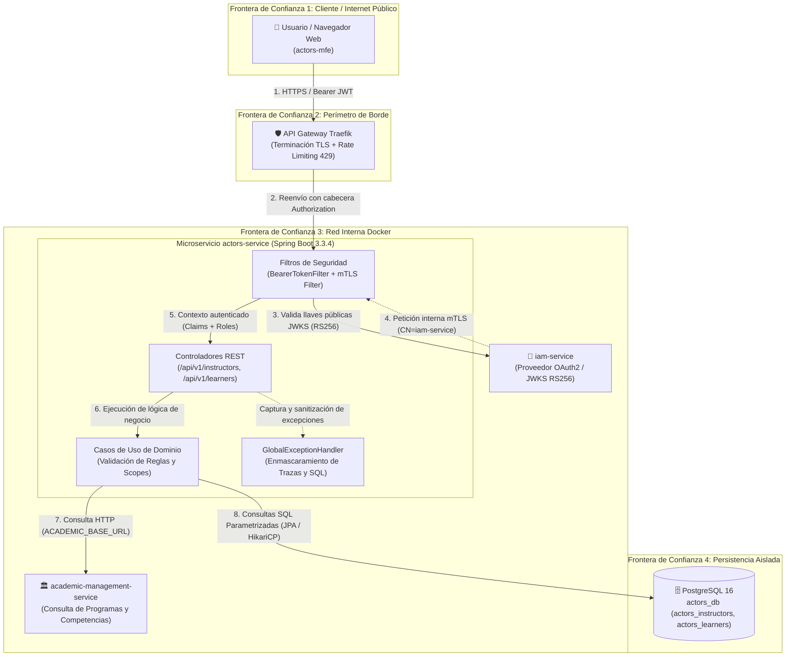

# Modelo de Amenazas STRIDE y Endurecimiento de Seguridad — actors-service

> **Estado:** 🟢 Aprobado | Última actualización: 2026-10-20  
> **Autora:** Laura Vanessa Pérez Perdomo (CC 1075228306 · `@vanessaperdomo`) | Dominio: Actors — Ficha ADSO-3145555  
> **Referencia Oficial:** Acta de Compromiso 02-2026 (Numeral 11.a) · Reto R4 Seguridad  

---

## 1. Contexto y Superficie de Ataque

El microservicio `actors-service` (Spring Boot 3.3.4 / Java 17) es el componente autoritativo responsable de la gestión de aprendices, instructores, contratos, matrículas en fichas, asignaciones de competencias, planes de mejoramiento y bitácoras de auditoría dentro del Ecosistema Horarios SENA.

Al procesar Datos Personales Sensibles (PII) bajo la **Ley Estatutaria 1581 de 2012 (*Habeas Data*)**, la superficie de ataque abarca:
1. **Perímetro de Borde / API Gateway (Traefik):** Peticiones públicas originadas desde microfrontends (`actors-mfe`).
2. **Red Interna Docker:** Tráfico servicio a servicio (M2M) con `iam-service` y `academic-management-service`.
3. **Persistencia Aislada:** Esquemas PostgreSQL (`actors_instructors`, `actors_learners`, `actors_tracking`).

---

## 2. Diagrama de Flujo de Datos (DFD) — Nivel 1

---

## 3. Matriz de Amenazas Identificadas y Mitigadas (STRIDE)

| Categoría STRIDE | ID Amenaza | Escenario de Ataque Evaluado | Componente Afectado | Mitigación Implementada | Caso de Prueba Verificado |
|---|:---:|---|---|---|---|
| **Spoofing** | TH-S01 | Token JWT con firma alterada o expirada | Filtro OAuth2 | Validación criptográfica RS256 contra JWKS; rechazo con HTTP 401 (`TOKEN_EXPIRED`, `TOKEN_INVALID`). | `test01`, `test02` |
| **Spoofing** | TH-S02 | Evasión de firma usando cabecera `{"alg": "none"}` | Decodificador JWT | `NimbusJwtDecoder` configurado estrictamente para requerir `JWSAlgorithm.RS256`. | `test03` |
| **Spoofing** | TH-S03 | Suplantación de servicio interno en sincronización | `InternalMtlsAuthenticationFilter` | Validación de certificado de cliente X.509 (`CN=iam-service`) para rutas `/internal/learners/**`. | `test14` |
| **Tampering** | TH-T01 | Inyección SQL en parámetros de filtrado | Spring Data JPA | Consultas 100% parametrizadas con Hibernate y sanitización de cadenas; rechaza o neutraliza sin error 500. | `test11` |
| **Tampering** | TH-T02 | Carga de contenido XSS en campos de texto JSON | Validadores Bean Validation | Anotación `@Pattern(regexp = "^[^<>]*$")` sobre `first_name`/`last_name` y Bean Validation estricta; rechaza payloads con HTTP 400 (`VALIDATION_ERROR`). | `test12` |
| **Tampering** | TH-T03 | Cabecera Authorization malformada o corrupta | Filtro de Seguridad | Rechazo inmediato con HTTP 401 (`TOKEN_INVALID`) sin procesar peticiones incompletas. | `test05` |
| **Repudiation** | TH-R01 | Negación de autoría en cambios de estado o contratos | Entidad `ActivityLog` | Registro append-only en `audit_activity_log` con `performed_by` asociado al `sub` del JWT y timestamp UTC. | `ActivityLogControllerIT` |
| **Information Disclosure** | TH-I01 | Lectura no autorizada de expediente ajeno (IDOR) | Controladores REST / `LearnerAuth` | Validación SpEL `@PreAuthorize("@learnerAuth.canViewLearner(#id)")` verificando que un usuario con `OWN_PROFILE` solo acceda a su propio expediente (HTTP 403). | `test09` |
| **Information Disclosure** | TH-I02 | Modificación no autorizada de aprendiz ajeno (IDOR) | Controladores REST / `LearnerAuth` | Validación SpEL `@PreAuthorize("@learnerAuth.canManageLearner(#id)")` impidiendo alteración cruzada entre expedientes de aprendices (HTTP 403). | `test10` |
| **Information Disclosure** | TH-I03 | Fuga de esquema de base de datos o trazas en fallos | `GlobalExceptionHandler` | Respuestas JSON uniformes (`ErrorResponse`) que ocultan stacktraces y sintaxis SQL ante HTTP 500 (`INTERNAL_ERROR`). | `test15` |
| **Information Disclosure** | TH-I04 | Petición anónima a recursos privados | `SecurityConfig` | Bloqueo por defecto de todas las rutas protegidas sin cabecera Authorization (HTTP 401 `MISSING_TOKEN`). | `test04` |
| **Denial of Service** | TH-D01 | Saturación de endpoints por ráfagas masivas (DoS) | `ReportRateLimiter` | Algoritmo Fixed Window Counter concurrente con límite por ventana de tiempo y respuesta HTTP 429 (`TOO_MANY_REQUESTS`). | `test13` |
| **Denial of Service** | TH-D02 | Paginación ilimitada agotando memoria JVM | `ActivityLog` / Controladores | Parámetros obligatorios `limit` con tope máximo institucional (`MAX_PAGE_SIZE = 50`) y cursor pagination. | `test06` de API |
| **Elevation of Privilege** | TH-E01 | Aprendiz intentando crear o modificar instructores | `@PreAuthorize` | RBAC granular: `ROLE_APPRENTICE` no posee autoridades `ACT_INSTRUCTOR_*`; responde con HTTP 403 (`INSUFFICIENT_PERMISSIONS`). | `test08` |
| **Elevation of Privilege** | TH-E02 | Token con ámbito (*scope*) de otro centro de formación | `InstructorAuth` / Service | Scopes `training_center_id` validados en cada operación; consulta de centro ajeno resulta en HTTP 403 (`SCOPE_VIOLATION`). | `test06` |
| **Elevation of Privilege** | TH-E03 | Token sin permisos sobre la ficha solicitada | `LearnerAuth` | Validación SpEL `@PreAuthorize("@learnerAuth.canBrowseLearners(#fichaId)")`; consulta de ficha ajena genera HTTP 403 (`INSUFFICIENT_PERMISSIONS`). | `test07` |

---

## 4. Trazabilidad

- **Decisión Arquitectural:** [05-architecture/decisions/records/ADR-015-actors-security-hardening.md](../../../05-architecture/decisions/records/ADR-015-actors-security-hardening.md)
- **Suite Automatizada:** `actors-adapters/src/test/java/co/sena/actors/adapter/in/rest/SecurityNegativeTests.java` (16 tests en verde)
- **Pull Request Backend:** [code-sena/design-software-actors-service#27](https://github.com/code-sena/design-software-actors-service/pull/27)
