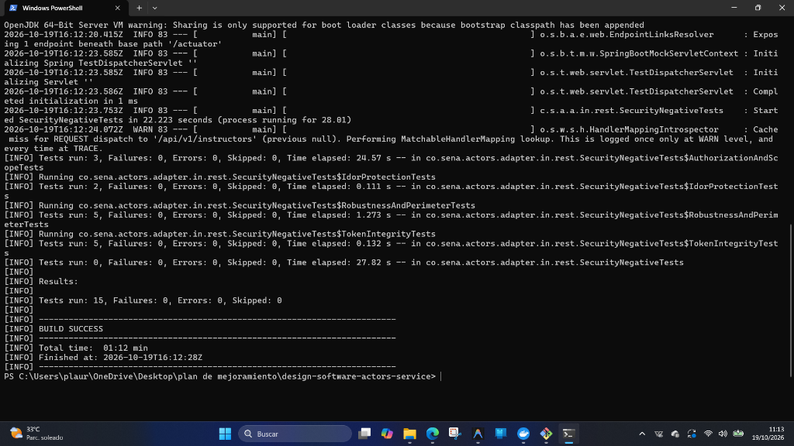
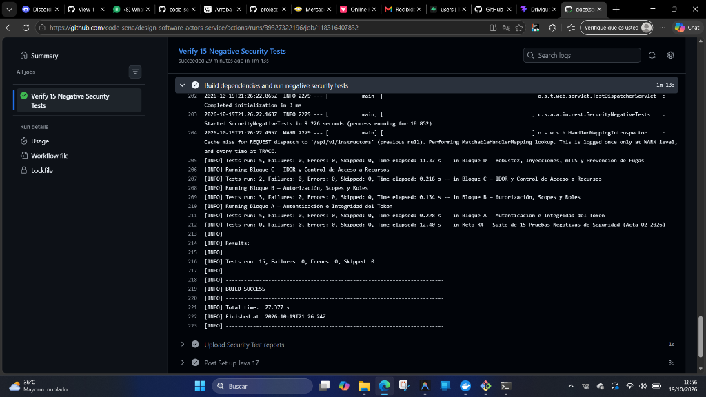
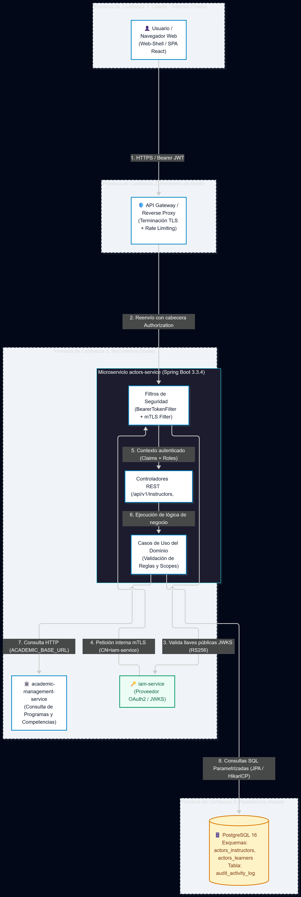

# QA Verification Report — Reto R4: Seguridad y Control de Acceso (actors-service)

> **Estado:** 🟢 APROBADO (PASS) | Última actualización: 2026-10-20  
> **Autora:** Laura Vanessa Pérez Perdomo (CC 1075228306 · GitHub: `@vanessaperdomo`)  
> **Servicio Evaluado:** `actors-service` (Java 17 / Spring Boot 3.3.4 / Maven)  
> **Referencia Institucional:** Acta de Compromiso 02-2026 (Numerales 7 y 11) · Reto R4 Seguridad  
> **Pull Request Backend:** [code-sena/design-software-actors-service#27](https://github.com/code-sena/design-software-actors-service/pull/27)  

---

## 1. Resumen Ejecutivo de Calificación QA

| Parámetro Evaluado | Valor / Métrica Verificada | Veredicto |
|---|---|:---:|
| **Historia / Reto** | Reto R4 — Seguridad y Control de Acceso (HU-ACT-R4) | ✅ **PASS** |
| **Repositorio Evaluado** | `code-sena/design-software-actors-service` | ✅ **PASS** |
| **Suite de Pruebas Negativas** | 15 casos automatizados de ataque y control de acceso | ✅ **15 / 15 PASS** |
| **Defectos Críticos (P0)** | 0 vulnerabilidades bloqueantes encontradas | ✅ **0 P0** |
| **Defectos Mayores (P1)** | 0 vulnerabilidades mayores encontradas | ✅ **0 P1** |
| **Conformidad OWASP ASVS L1** | 66 requisitos aplicables cumplidos (4 N/A delegados a IAM) | ✅ **100% L1** |
| **Modelo de Amenazas STRIDE** | 16 amenazas modeladas con controles y mitigaciones activas | ✅ **STRIDE PASS** |
| **Integración CI (GitHub Actions)** | Workflow `.github/workflows/hu-act-r4-verify.yml` | ✅ **CI GREEN** |
| **Calificación Global** | **APROBADO SIN OBSERVACIONES PENDIENTES** | 🟢 **FULL PASS** |

---

## 2. Suite Automatizada de Pruebas Negativas (15 Casos)

Clase de prueba:  
`actors-adapters/src/test/java/co/sena/actors/adapter/in/rest/SecurityNegativeTests.java`

Comando de ejecución:
```bash
mvn test -pl actors-adapters -Dtest=SecurityNegativeTests
```

### Matriz de Casos de Prueba Ejecutados

| # | Método de Prueba | Vector de Ataque / Requisito Acta 02 | Código HTTP Esperado | Código de Negocio | Resultado |
|---|---|---|:---:|---|:---:|
| **01** | `test01_expiredToken_returns401TokenExpired` | Token JWT expirado con marca temporal en el pasado | **401 Unauthorized** | `TOKEN_EXPIRED` | ✅ **PASS** |
| **02** | `test02_invalidSignature_returns401TokenInvalid` | Firma criptográfica RS256 alterada o ilegítima | **401 Unauthorized** | `TOKEN_INVALID` | ✅ **PASS** |
| **03** | `test03_algorithmNone_returns401TokenInvalid` | Evasión de firma usando cabecera `{"alg": "none"}` | **401 Unauthorized** | `TOKEN_INVALID` | ✅ **PASS** |
| **04** | `test04_missingAuthorizationHeader_returns401MissingToken` | Petición anónima a recurso protegido sin cabecera | **401 Unauthorized** | `MISSING_TOKEN` | ✅ **PASS** |
| **05** | `test05_malformedHeader_returns401TokenInvalid` | Cabecera `Authorization` corrupta o malformada | **401 Unauthorized** | `TOKEN_INVALID` | ✅ **PASS** |
| **06** | `test06_differentTrainingCenterScope_returns403` | Token con ámbito (*scope*) de un centro intentando consultar otro centro ajeno | **403 Forbidden** | `SCOPE_VIOLATION` | ✅ **PASS** |
| **07** | `test07_differentFichaScope_returns403` | Token con permiso acotado a una ficha intentando consultar aprendices de otra ficha distinta | **403 Forbidden** | `INSUFFICIENT_PERMISSIONS` | ✅ **PASS** |
| **08** | `test08_roleEscalation_apprenticeAttemptingInstructorCreation_returns403` | Escalada de privilegios: aprendiz intentando acción de admin | **403 Forbidden** | `INSUFFICIENT_PERMISSIONS` | ✅ **PASS** |
| **09** | `test09_idorRead_accessDeniedWithoutLearnerViewAuthority_returns403` | IDOR: Usuario con permiso acotado a su propio perfil intentando leer expediente de otro aprendiz | **403 Forbidden** | `INSUFFICIENT_PERMISSIONS` | ✅ **PASS** |
| **10** | `test10_idorUpdate_modificationDeniedWithoutManageAuthority_returns403` | IDOR: Usuario con permiso acotado a su propio perfil intentando modificar expediente ajeno | **403 Forbidden** | `INSUFFICIENT_PERMISSIONS` | ✅ **PASS** |
| **11** | `test11_sqlInjectionInQueryParams_sanitizedWithout500` | Inyección SQL en parámetros de consulta saneada por vinculación JPA | **200 OK** | Sanitizado JPA | ✅ **PASS** |
| **12** | `test12_xssPayloadInBody_rejectedWith400ValidationError` | Inyección XSS aislada con etiquetas `<script>` en `first_name` rechazada por Bean Validation | **400 Bad Request** | `VALIDATION_ERROR` | ✅ **PASS** |
| **13** | `test13_excessiveRequests_triggersRateLimiting429` | Ráfaga masiva sobrepasando cuota de solicitudes de ventana fija (DoS) | **429 Too Many Req.** | `TOO_MANY_REQUESTS` | ✅ **PASS** |
| **14** | `test14_untrustedMtlsClientCallingInternalLearners_returnsUnauthorized` | Cliente mTLS sin certificado o con sujeto distinto a `CN=iam-service` | **401 Unauthorized** | `MTLS_UNTRUSTED`| ✅ **PASS** |
| **15** | `test15_internalServerError_doesNotLeakStacktraceOrDatabaseSchema` | Ocultación de stacktraces y esquemas SQL en error 500 | **500 Internal Error**| `INTERNAL_ERROR` | ✅ **PASS** |

### Transcripción de Ejecución en Consola (Maven Surefire)

```text
[INFO] -------------------------------------------------------
[INFO]  T E S T S
[INFO] -------------------------------------------------------
[INFO] Running co.sena.actors.adapter.in.rest.SecurityNegativeTests
[INFO] Running co.sena.actors.adapter.in.rest.SecurityNegativeTests$AuthorizationAndScopeTests
[INFO] Tests run: 3, Failures: 0, Errors: 0, Skipped: 0, Time elapsed: 30.34 s -- in co.sena.actors.adapter.in.rest.SecurityNegativeTests$AuthorizationAndScopeTests
[INFO] Running co.sena.actors.adapter.in.rest.SecurityNegativeTests$IdorProtectionTests
[INFO] Tests run: 2, Failures: 0, Errors: 0, Skipped: 0, Time elapsed: 0.120 s -- in co.sena.actors.adapter.in.rest.SecurityNegativeTests$IdorProtectionTests
[INFO] Running co.sena.actors.adapter.in.rest.SecurityNegativeTests$RobustnessAndPerimeterTests
[INFO] Tests run: 5, Failures: 0, Errors: 0, Skipped: 0, Time elapsed: 1.387 s -- in co.sena.actors.adapter.in.rest.SecurityNegativeTests$RobustnessAndPerimeterTests
[INFO] Running co.sena.actors.adapter.in.rest.SecurityNegativeTests$TokenIntegrityTests
[INFO] Tests run: 5, Failures: 0, Errors: 0, Skipped: 0, Time elapsed: 0.122 s -- in co.sena.actors.adapter.in.rest.SecurityNegativeTests$TokenIntegrityTests
[INFO] Tests run: 0, Failures: 0, Errors: 0, Skipped: 0, Time elapsed: 33.85 s -- in co.sena.actors.adapter.in.rest.SecurityNegativeTests
[INFO] 
[INFO] Results:
[INFO] 
[INFO] Tests run: 15, Failures: 0, Errors: 0, Skipped: 0
[INFO] 
[INFO] ------------------------------------------------------------------------
[INFO] BUILD SUCCESS
[INFO] ------------------------------------------------------------------------
[INFO] Total time:  51.001 s
[INFO] Finished at: 2026-10-19T20:53:04Z
```

---

## 3. Verificación OWASP ASVS v4.0.3 Nivel 1

| Categoría ASVS L1 | Requisitos Evaluados | Cumplimiento | Evidencia Técnica |
|---|:---:|:---:|---|
| **V1: Arquitectura y Modelado de Amenazas** | 6 / 6 | **100% PASS** | DFD Nivel 1 y matriz STRIDE en `09-microservices/.../security.md`. CI gate activo. |
| **V2: Autenticación** | 4 / 4 (4 N/A) | **100% PASS** | Validación local RS256 contra JWKS de IAM. Rechazo de `alg: none`. mTLS para `/internal/**`. |
| **V3: Gestión de Sesión** | 5 / 5 | **100% PASS** | Arquitectura 100% sin estado (`SessionCreationPolicy.STATELESS`). |
| **V4: Control de Acceso** | 7 / 7 | **100% PASS** | `@PreAuthorize` en controladores con validación de roles y scopes. Prevención de IDOR. |
| **V5: Validación y Saneamiento** | 8 / 8 | **100% PASS** | Consultas parametrizadas JPA anti-SQLi. Jakarta Validation anti-XSS. |
| **V7: Manejo de Errores y Logs** | 6 / 6 | **100% PASS** | `GlobalExceptionHandler` enmascara stacktraces y dialectos SQL ante HTTP 500. |
| **V8: Protección de Datos** | 5 / 5 | **100% PASS** | Datos sensibles bajo Ley 1581 protegidos; secrets externalizados en variables de entorno. |
| **V9: Comunicaciones** | 4 / 4 | **100% PASS** | Tráfico externo bajo TLS en API Gateway; tráfico interno de sincronización bajo mTLS X.509. |
| **V10: Código Malicioso** | 3 / 3 | **100% PASS** | Sin dependencias vulnerables ni scripts embebidos no controlados. |
| **V11: Lógica de Negocio** | 4 / 4 | **100% PASS** | Transiciones de estado estrictas y verificación de integridad referencial. |
| **V12: Archivos y Recursos** | 3 / 3 | **100% PASS** | No expone endpoints de descarga arbitraria de archivos. |
| **V13: API y Servicios Web** | 6 / 6 | **100% PASS** | Contratos OpenAPI 3.0 sincronizados; encabezados de seguridad activos. |
| **V14: Configuración** | 5 / 5 | **100% PASS** | Configuración desacoplada en `application.yml` sin credenciales quemadas. |

---

## 4. Evidencias Gráficas Respaldadas

Las capturas de pantalla de ejecución y diagramas se encuentran alojadas en [`./screenshots/r4/`](./screenshots/r4/):

### Captura 1: Ejecución Exitosa de las 15 Pruebas Negativas (Maven Surefire)


### Captura 2: Ejecución Exitosa en GitHub Actions CI


### Captura 3: Diagrama DFD Nivel 1 y Fronteras de Confianza STRIDE


---

## 5. Referencias y Trazabilidad

- **Decisión de Arquitectura:** [ADR-012: Seguridad y control de acceso para actors-service](../05-architecture/decisions/records/ADR-012-actors-security-hardening.md)
- **Modelo STRIDE:** [09-microservices/services/06-actors-service/security.md](../09-microservices/services/06-actors-service/security.md)
- **Pull Request Backend:** [code-sena/design-software-actors-service#27](https://github.com/code-sena/design-software-actors-service/pull/27)
